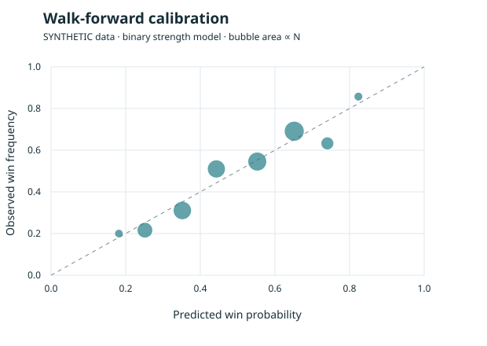
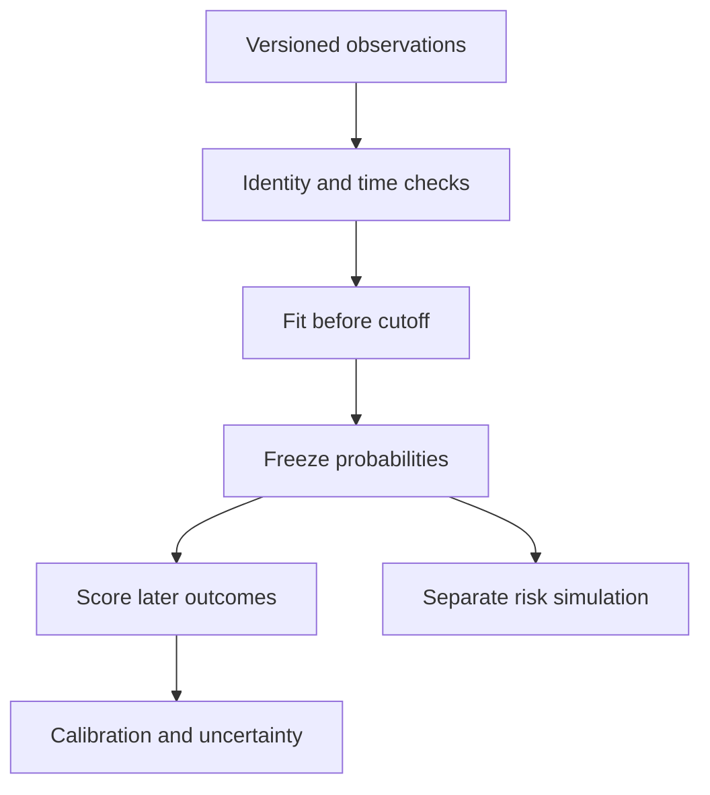

# Sports Probability Lab

**Probability modelling, chronological evaluation, and risk simulation across sports.**

An independent research portfolio by **Muhuan (Mathias) Chen**. This repository presents selected methods from a broader seven-domain sports research project through small, runnable reference implementations. It is intended for quantitative research, sports analytics, and trading interviews.

**Start here:** [research case studies](docs/CASE_STUDIES.md) · [modelling decisions](docs/METHODS.md) · [run the demo](#reproduce-the-demo) · [tests](tests/test_models.py)

## What you can inspect in five minutes

| Research question | Implementation | What to look for |
| --- | --- | --- |
| How should noisy results update relative strength? | [Weighted Bradley–Terry](src/sports_probability/models.py) | L2 shrinkage, exclusive time cutoffs, identified strength differences |
| How does unit win probability become a match probability? | [Series mapping](src/sports_probability/models.py) | Binomial vs beta-binomial assumptions, format sensitivity |
| How can low-score dependence alter football probabilities? | [Poisson + Dixon–Coles](src/sports_probability/models.py) | Feasible correction factors, tail mass, H/D/A normalization |
| How do predicted basketball margins map to wins? | [Weighted ridge + Gaussian CDF](src/sports_probability/models.py) | Mean/scale separation and a documented calibration limitation |
| Is a model better than its comparator on the same observations? | [Evaluation](src/sports_probability/evaluation.py) | Proper scores, paired availability, date-cluster bootstrap |
| What does apparent edge imply for path risk? | [Risk simulation](src/sports_probability/risk.py) | Maximum drawdown, Monte Carlo uncertainty, independence assumptions |

The public examples are deliberately compact. They do not reproduce every player, lineup, workload, or state-update component of the larger system. See the [scope map](docs/CASE_STUDIES.md#scope-map).

## Reproduce the demo

Python 3.11+; no API keys, connected accounts, or data downloads are needed to run it after dependencies are installed.

```bash
python -m venv .venv
# macOS / Linux:
source .venv/bin/activate
# Windows PowerShell instead: .venv\Scripts\Activate.ps1
python -m pip install -e .
python -m unittest discover -s tests -v
python -m sports_probability.demo --output results
```

The demo generates 1,200 anonymous synthetic observations on 400 synthetic dates. Four expanding-window folds fit strictly before each test window. There are 600 held-out observations; the model/comparator paired subset contains 514 because comparator probabilities are deliberately withheld on some rows.

| Demonstration | Held-out N | Brier (half-sum convention) | Log loss |
| --- | ---: | ---: | ---: |
| Binary strength model | 600 | 0.217289 | 0.624628 |
| Simplified basketball margin model | 600 | 0.221437 | 0.633966 |

**These are synthetic software-demonstration results. They are not scores on real matches, a live track record, or evidence of profitable trading.** The generated noisy comparator is not bookmaker data. Fixed hyperparameters are illustrative, not tuned on these test folds. Exact last-digit results can vary across numerical-library versions.



The [machine-readable report](results/synthetic_report.json) includes fold boundaries, fair-coin and synthetic comparator baselines, calibration counts, paired scores, a date-cluster bootstrap interval, and risk examples. The [environment snapshot](results/environment.json) records the libraries used to produce the checked-in results.

## Research judgement beyond fitting

- **A better retrospective score is not a prospective result.** Historical source revisions, model selection, and reused evaluation periods can overstate evidence.
- **Compare like with like.** Model and market scores use the same complete paired subset. An independently scored model-only sample is labelled separately.
- **Keep probability estimation separate from decision policy.** Prices do not enter these probability models; sizing assumptions are explicit downstream inputs.
- **Treat format and identity as model inputs.** Best-of length, regulation vs overtime scores, team identity, and forecast-time information change what is being predicted.
- **Report negative or inconclusive findings.** The [case studies](docs/CASE_STUDIES.md) include a basketball extension whose historical uncertainty interval did not establish a stable improvement.

## Engineering approach



The broader project uses explicit version/state checks and replayable predictions. This public implementation focuses on the numerical core and validation design. It runs offline and does not connect to betting platforms or place orders.

## Repository guide

```text
src/sports_probability/   Reference models, metrics, risk simulator, offline demo
tests/                   Numerical invariants, temporal and missing-data checks
docs/                    Methods, research case studies, provenance and limitations
results/                 Clearly labelled synthetic report and calibration figure
.github/workflows/       Automated software checks
```

## Authorship and scope

I set the research questions, review modelling assumptions and validation evidence, reconcile source/identity issues, and make project decisions. Development uses AI coding assistance. This repository is a curated reference implementation prepared with that assistance; it is not a verbatim export of the operational system.

No account balances, individual positions, execution archives, production coefficients, credentials, or linked-workspace identifiers are distributed. Read [data and provenance](docs/DATA_AND_PROVENANCE.md) for the boundary between reproducible synthetic examples and historical project summaries.

No open-source licence is granted at this stage; see [NOTICE](NOTICE). Repository visibility should not be confused with a broad reuse licence.
